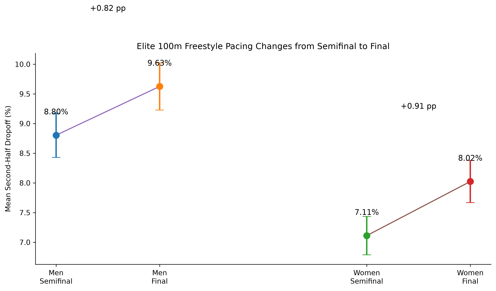
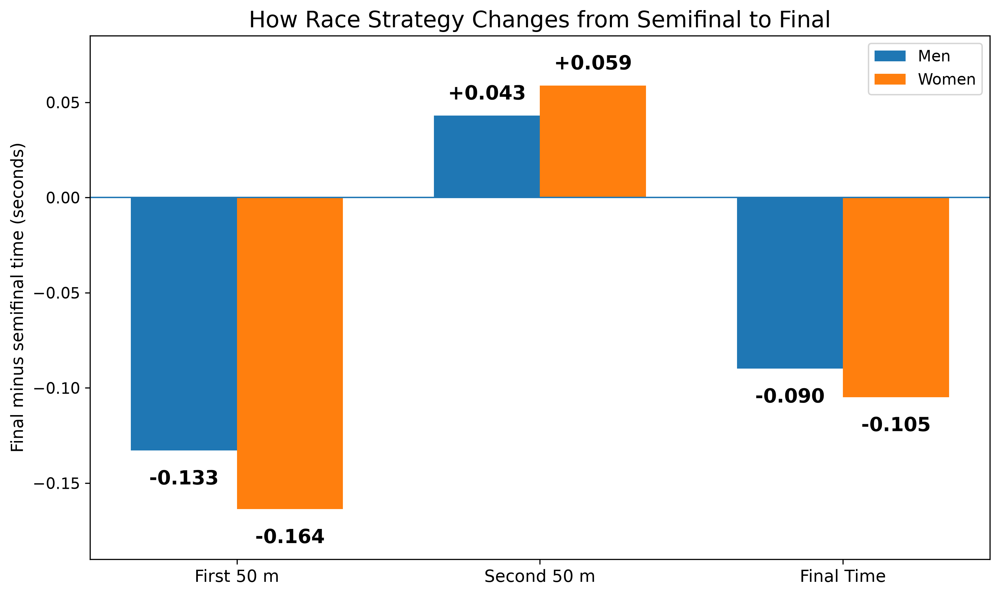

# Elite 100m Freestyle Performance Analysis

**[Open the live dashboard](https://elite-100m-freestyle.streamlit.app/)** · Python · SQL · Streamlit · GEE / mixed-effects models

## Summary

Using 4,896 race results from 21 Olympic Games and World Championships (2000–2025), this project asks how elite swimmers change their pacing between the semifinal and the final of the 100m freestyle.

- **Swimmers slow down more in finals.** Among athletes who swam both rounds of the same meet, second-half dropoff rose by 0.82 percentage points for men and 0.91 for women (Cohen's dz 0.40 and 0.53; bootstrap 95% CIs entirely above zero).
- **The cause is a faster start, not a weaker finish.** In finals, swimmers' first 50 m was 0.13–0.16 s faster while their second 50 m was only 0.04–0.06 s slower, so overall times still improved.
- **An apparent long-term trend was an artifact.** A simple OLS model suggested men's dropoff declined over 25 years, but the effect disappeared once repeated observations of the same swimmer were modeled with GEE.





## Project Overview

This project analyzes elite men's and women's 100m freestyle performances from major international long-course competitions between 2000 and 2025.

The analysis uses Python to collect, clean, validate, and analyze race-level data from the World Aquatics API.

The primary research question is:

**How does pacing behavior change between the semifinal and final of elite 100m freestyle competitions?**

Men and women are analyzed separately for the main analyses.

## Data

The dataset includes performances from:

- Olympic Games
- FINA World Championships
- World Aquatics Championships

The study covers 21 major international competitions from 2000 through 2025.

The complete race database contains:

- 2,767 men's race observations
- 2,129 women's race observations
- 4,896 total race observations
- 1,167 unique male swimmers
- 824 unique female swimmers

The primary elite analysis sample is restricted to semifinal and final performances with complete 50 m split and final-time data.

Primary analysis sample:

- Men: 407 performances from 136 swimmers
- Women: 431 performances from 127 swimmers
- Combined: 838 elite performances

Because many swimmers appear repeatedly across rounds and competitions, the statistical analysis accounts for within-swimmer dependence.

## Key Variables

The project contains two closely related pacing measures.

### Second-Half Difference

The interactive dashboard primarily uses:

**Second-Half Difference (s) = Second 50 m - First 50 m**

This represents how many seconds longer the swimmer took to complete the second 50 m compared with the first 50 m.

For example, if the first 50 m is 23.00 seconds and the second 50 m is 25.10 seconds:

**Second-Half Difference = 2.10 seconds**

A larger value indicates greater slowing during the second half of the race.

### Percentage Dropoff

The primary statistical pacing models use percentage dropoff:

**Dropoff (%) = ((Second 50 m - First 50 m) / First 50 m) x 100**

This normalizes second-half slowing relative to the swimmer's first 50 m and is useful for statistical comparisons across athletes with different absolute swimming speeds.

Additional variables include:

- Final 100 m time
- First 50 m split
- Second 50 m split
- Reaction time
- Athlete age
- Competition year
- Race round
- Athlete height
- Athlete weight

## Main Findings

### 1. Semifinal-to-final pacing changes

Among swimmers who competed in both the semifinal and final of the same competition, second-half pacing deterioration increased in the final.

Men:

- Paired swimmers: 136
- Semifinal mean percentage dropoff: 8.80%
- Final mean percentage dropoff: 9.63%
- Mean increase: 0.82 percentage points
- Cohen's dz: 0.40
- 67.6% of swimmers showed greater percentage dropoff in the final

Women:

- Paired swimmers: 144
- Semifinal mean percentage dropoff: 7.11%
- Final mean percentage dropoff: 8.02%
- Mean increase: 0.91 percentage points
- Cohen's dz: 0.53
- 70.1% of swimmers showed greater percentage dropoff in the final

Bootstrap confidence intervals were fully above zero for both men and women.

### 2. Mechanism of the semifinal-to-final change

The larger final-round second-half difference appears to be associated primarily with a faster opening 50 m.

Men:

- First 50 m: 0.133 s faster in finals
- Second 50 m: 0.043 s slower
- Final time: 0.090 s faster overall
- Second-Half Difference: 0.176 s larger

Women:

- First 50 m: 0.164 s faster in finals
- Second 50 m: 0.059 s slower
- Final time: 0.105 s faster overall
- Second-Half Difference: 0.223 s larger

This pattern indicates that swimmers generally produce faster overall final performances while opening more aggressively and slowing more during the second half relative to the first half.

These are observational associations and should not be interpreted as causal effects.

### 3. Long-term pacing trends

Simple OLS models suggested a decline in male percentage dropoff over time, but this association weakened after accounting for repeated observations from the same swimmer.

Population-average GEE models found:

- Men: no statistically significant long-term pacing trend
- Women: no statistically significant long-term pacing trend

This demonstrates why repeated-measures modeling is important when the same athletes appear many times in the dataset.

### 4. Height and performance

Physical characteristics were enriched using Wikidata.

Height data were available for:

- 86 of 136 men
- 89 of 127 women

After accounting for competition year, age, reaction time, race round, and repeated athlete observations:

Men:

- No clear association between height and final time
- No clear association between height and first or second 50 m performance

Women:

- Greater height was associated with faster final times
- Greater height was especially associated with faster second 50 m performance

Formal height-by-sex interaction tests were statistically significant for:

- Final time
- Second 50 m

No significant interaction was detected for:

- First 50 m
- Percentage dropoff

These findings are observational and may be affected by incomplete historical physical-data coverage and residual confounding.

## Statistical Highlights

The project goes beyond descriptive analysis and applies inferential and repeated-measures methods to elite swimming performance.

Key statistical components include:

- Paired semifinal-to-final analysis using paired t-tests
- Wilcoxon signed-rank robustness tests
- Bootstrap confidence intervals
- Cohen's dz effect sizes
- OLS regression
- Cluster-robust standard errors
- Mixed-effects models
- Generalized Estimating Equations (GEE)
- Height-by-sex interaction models
- Missing-data diagnostics

The primary paired analysis found that second-half pacing deterioration increased significantly from semifinal to final for both men and women.

Repeated-measures methods were required because many swimmers appear multiple times across competitions and race rounds.

## Statistical Methods

The project uses:

- Descriptive statistics
- Pearson correlations
- Paired t-tests
- Wilcoxon signed-rank tests
- Bootstrap confidence intervals
- Cohen's dz effect sizes
- OLS regression
- Cluster-robust standard errors
- Mixed-effects models
- Generalized Estimating Equations
- Interaction models
- Missing-data diagnostics

GEE models are used as the primary population-average approach when repeated observations from the same swimmer must be accounted for.

## Data Quality

The cleaning pipeline performs:

- Duplicate detection
- Swimming-time parsing
- Split consistency checks
- Plausibility checks
- Missing-value reporting
- Outlier inspection

World Aquatics race times may appear in either seconds format or minute-second format, so the cleaning pipeline standardizes both formats before analysis.

Extreme pacing observations are concentrated primarily in preliminary heats and do not enter the primary semifinal/final analysis sample.

## Limitations

- **Observational data.** The semifinal-to-final differences are associations. Finals differ from semifinals in pressure, lane draw, and what is at stake, so the analysis cannot isolate a single cause.
- **Selected sample.** Only swimmers fast enough to reach a final appear in the paired analysis, so the results describe the world's top sprinters, not swimmers in general.
- **Incomplete physical data.** Height is available for about two-thirds of athletes, and Wikidata values may not reflect each swimmer's measurements at the time of competition.
- **Multiple comparisons.** The height analysis tests several outcomes for each sex, so an individual significant result there should be treated as exploratory.
- **Two-split resolution.** Only 50 m splits are available, so finer pacing patterns (for example, the last 15 m) cannot be studied.

## Physical Data

Athlete physical characteristics were enriched using Wikidata.

The enrichment pipeline includes:

- Exact name matching
- Fuzzy name matching
- Manual validation of uncertain matches
- Height and weight plausibility checks
- Missingness analysis

Final physical-data coverage:

- 263 athletes in the primary sample
- 175 with height data
- 137 with weight data
- 242 validated Wikidata matches

Physical characteristics should be interpreted cautiously because historical athlete profiles may not always represent measurements taken at the exact time of competition.

## SQL Analysis

The project includes a SQLite database layer for relational querying and joins.

The database contains:

- `race_results` - all 4,896 race observations
- `elite_race_results` - a SQL view containing the 838 primary semifinal/final observations
- `athletes` - 263 athletes with physical-characteristic data

Example SQL analyses include:

- Average pacing by sex and race round
- Average final time by sex and race round
- Fastest elite performances
- Swimmers with the most elite race observations
- Year-by-year pacing summaries
- Joins between race performance and athlete physical characteristics

The SQL queries are stored in:

`sql/analysis_queries.sql`

The SQLite database is generated using:

`src/07_build_database.py`

The Streamlit app automatically builds the database if it is not already available.

## Interactive Dashboard

The Streamlit dashboard provides an interactive presentation layer on top of the Python and SQL analysis.

It includes:

- Overview of elite performance
- Sex and year filters
- Semifinal and final comparisons
- First 50 m and second 50 m summaries
- Second-Half Difference analysis
- Fastest elite performances
- Performance trends over time
- Paired semifinal-to-final visualizations
- Athlete-level exploration
- Physical-characteristic analysis
- Dedicated inferential statistical analysis
- GEE, interaction, bootstrap, effect-size, and paired-test results

Live dashboard:

[https://elite-100m-freestyle.streamlit.app/](https://elite-100m-freestyle.streamlit.app/)

## Project Structure

```text
elite-100m-freestyle-analysis/
|
├── app/
│   ├── app.py
│   └── statistical_analysis.py
|
├── data/
│   ├── raw/
│   └── processed/
|
├── outputs/
│   ├── figures/
│   └── tables/
|
├── sql/
│   └── analysis_queries.sql
|
├── src/
│   ├── 01_collect_data.py
│   ├── 02_clean_data.py
│   ├── 03_build_analysis_sample.py
│   ├── 04_descriptive_analysis.py
│   ├── 05_pacing_models.py
│   ├── 06_semifinal_final_analysis.py
│   ├── 07_build_database.py
│   ├── 30_physical_data_enrichment.py
│   └── 31_physical_performance_analysis.py
|
├── README.md
├── requirements.txt
└── .gitignore
```

## Reproducible Pipeline

The project follows a reproducible workflow from raw data collection to statistical analysis and deployment.

### 1. Collect and prepare race data

```bash
python src/01_collect_data.py
python src/02_clean_data.py
python src/03_build_analysis_sample.py
python src/04_descriptive_analysis.py
python src/05_pacing_models.py
python src/06_semifinal_final_analysis.py
```

### 2. Enrich athlete physical characteristics

```bash
python src/30_physical_data_enrichment.py
python src/31_physical_performance_analysis.py
```

Step 2 queries Wikidata live, so match counts can shift slightly as Wikidata is edited. Uncertain name matches were reviewed by hand; that review is recorded in `data/processed/wikidata_name_match_review.csv` and in the `MANUAL_APPROVED` list inside `30_physical_data_enrichment.py`.

### 3. Build the SQLite database

This step needs `athlete_master_physical_clean.csv`, which step 2 creates.

```bash
python src/07_build_database.py
```

### 4. Run the SQL analysis

```bash
sqlite3 -header -column data/swimming_analysis.db < sql/analysis_queries.sql
```

### 5. Launch the interactive dashboard

```bash
streamlit run app/app.py
```

The public dashboard is available here:

[Open the Elite 100m Freestyle Dashboard](https://elite-100m-freestyle.streamlit.app/)

---

## Main Outputs

The pipeline produces statistical tables, model results, and visualizations for the main research questions.

### Figures

- Paired semifinal-to-final pacing trajectories
- Semifinal-to-final difference distributions
- Main pacing comparison figure
- Semifinal-to-final mechanism figure
- Performance trends over time
- Athlete-level performance visualizations

### Tables

- Descriptive statistics
- Correlation analysis
- Pacing model summaries
- Paired semifinal-to-final results
- Bootstrap confidence intervals
- Height-performance GEE models
- Height-by-sex interaction models
- Physical-performance correlations

---

## Statistical Limitations

The results should be interpreted with several important limitations in mind:

- **Observational design** - the analysis identifies statistical associations and should not be interpreted as causal.
- **Incomplete physical data** - height and weight coverage is lower for older competitions.
- **Timing of physical measurements** - athlete height and weight records may not correspond exactly to the date of competition.
- **Repeated athlete observations** - swimmers appear multiple times across competitions and race rounds, requiring repeated-measures methods such as GEE and mixed-effects models.
- **Target leakage** - final time is mathematically determined by the first and second 50 m splits, so using both splits to predict final time would not represent a meaningful predictive model.
- **Country representation** - country should not be interpreted as a causal explanation of swimming performance.

---

## Interpretation

The clearest result is a consistent semifinal-to-final pacing shift.

Elite swimmers generally produce a **faster first 50 m in the final**, followed by a **larger second-half slowdown**, while still recording a **faster overall 100 m time**.

The paired design strengthens this finding because the same swimmer is compared between semifinal and final performances within the same competition.

The broader statistical framework also accounts for repeated observations from the same athletes using methods such as **Generalized Estimating Equations (GEE)** and **mixed-effects models**.

---

## Data Sources

### Race Performance Data

- World Aquatics API

### Physical Athlete Data

- Wikidata

---

## Technologies

### Data Analysis

- Python
- pandas
- NumPy
- SciPy
- statsmodels
- scikit-learn

### Visualization and Application

- matplotlib
- Streamlit

### Data Engineering

- requests
- SQLite
- SQL

### Version Control and Deployment

- Git
- GitHub
- Streamlit Community Cloud

---

## Author

**Daniel Eichel**

Statistics and Data Science Portfolio Project
